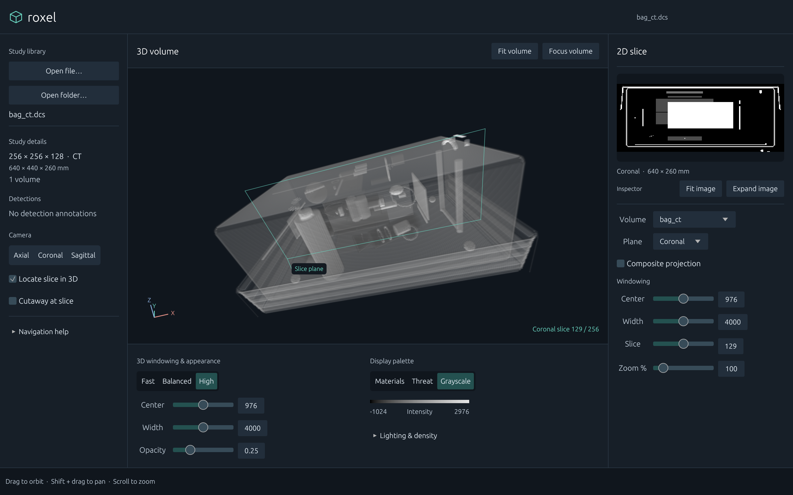

# Roxel

A GPU-accelerated DICOS volume inspection workspace, built with wgpu and egui.



## Run

```sh
cargo run -p roxel --release
cargo run -p roxel --release -- scan.dcs
cargo run -p roxel --release -- /path/to/study/
```

Use **Open file** for a `.dcs` or `.dcm` file, or **Open folder** for volume
layers from a directory. Loading and gradient preparation run on a worker
thread. The existing study remains visible while a replacement loads; errors
appear in the library panel. Directory loading keeps readable image files as
separate named layers; it does not automatically stack those layers. Failed
files are logged. See the [API review](../../docs/reviews/dicos-api-review.md)
for existing ingestion limitations.

## Inspect a study

The library sits on the left, the 3D view in the center, and the slice inspector
on the right. Rendering controls sit below the 3D view. Sidebars and the controls
shelf can be resized; long study names truncate with the full identifier on hover.
The minimum window size is 1100 × 720 logical pixels.

New studies open with an oblique, automatically fitted 3D view and a mid-coronal
2D slice. Grayscale, High sampling quality, and 25% global opacity are the
inspection defaults. Grayscale lifts midtones using `0.9 * normalized^0.65`;
its alpha remains linear. Lighting includes an adjustable depth cue that dims
more distant samples. These are display transforms, not changes to voxel data. Auto windowing, slices and 3D use the same rescale-intercept domain. Signed samples and non-unit rescale slopes remain unsupported; see the API review.

| Action | Result |
|---|---|
| Left-drag in the 3D viewport | Orbit |
| Shift + left-drag | Pan |
| Scroll in the 3D viewport | Zoom |
| Axial / Coronal / Sagittal | Snap and fit the camera |
| Fit volume | Recenter and frame the complete volume |
| Focus volume | Enlarge the volume; keep windowing, opacity, palette and lighting available |
| Escape / Exit focus | Return to the workspace |
| Locate slice in 3D | Outline the selected voxel-center plane |
| Cutaway at slice | Hide voxels before the selected plane to expose the remaining interior |

The axis triad shows **volume X/Y/Z**, not patient anatomical directions. The
slice locator and cutaway apply only when 2D and 3D display the same volume and
the 2D view is a single slice. Cutaway retains the half-volume at or after the
selected slice along the selected array axis. **Reverse cutaway** retains the opposite half; the plane label names the retained axis direction. It does not edit or export data.
Annotation boxes describe their original positions and are not cut away.

## Slice inspection

Choose a volume and plane, then navigate using the one-based slice number.
**Composite projection** uses the current transfer function for front-to-back
alpha compositing; the initial view is a single grayscale slice. Window center
and width controls affect the 2D view independently of the 3D controls. Slider
tracks use the study's initial window for useful adjustment resolution; numeric
entry permits a wider range. Values are not labelled as calibrated HU.

**Expand image** opens a modal inspector with a large fitted image, previous/next
buttons, an editable slice number, a wide navigation slider, windowing and zoom.
Drag the enlarged image to pan when zoomed; **Fit image** restores 100% fit.
**Back to workspace**, Escape, or clicking the backdrop closes the inspector.
Nearest-neighbor image sampling preserves the visible source pixels. Both views preserve physical aspect ratios from voxel spacing; slice captions report the physical field of view. The expanded inspector keeps the study identifier visible and includes a physical scale bar that follows zoom.

## Appearance

| Palette | Display |
|---|---|
| Grayscale | Lifted grayscale midtones with linear alpha; startup default |
| Materials | Five named density bands, editable thresholds and opacity |
| Threat | Red density highlight; does not itself identify threats |

**Lighting & density** reveals ambient, diffuse, specular, depth cue and density
cutoff. Material bands are hidden until requested. Quality selects Fast,
Balanced or High ray-march sampling. Opacity is corrected for the physical distance represented by each ray sample, so changing sampling quality does not intentionally change optical thickness. Extremely long rays use a coarser step to preserve full-volume coverage within the step budget. High costs more GPU work; choose Balanced
or Fast on slower hardware. No performance benchmark is implied by the labels.

Detected annotations are listed separately from display palettes. Absence of
annotations means none were supplied, not that the study is clear of threats.

## Reproducible screenshots

The application can read back its own rendered GPU frame, including egui and
the actual loaded volume. It waits for loading to finish and several UI frames
to settle, writes a PNG, and exits. This requires a desktop session and a
compatible GPU, just like ordinary use.

```sh
mkdir -p /tmp/roxel-review
ROXEL_SCREENSHOT=/tmp/roxel-review/workspace.png \
  cargo run -p roxel --release -- testdata/bag_ct.dcs

ROXEL_SCREENSHOT=/tmp/roxel-review/small.png \
ROXEL_SCREENSHOT_SIZE=1100x720 \
  cargo run -p roxel --release -- testdata/bag_ct.dcs
```

Capture options only apply when `ROXEL_SCREENSHOT` is set:

- `ROXEL_SCREENSHOT_SIZE=WIDTHxHEIGHT`: logical window size; output PNG dimensions
  also depend on the display scale.
- `ROXEL_SCREENSHOT_EXPANDED=1`: open expanded slice inspection.
- `ROXEL_SCREENSHOT_FOCUS=1`: open focused volume inspection.
- `ROXEL_SCREENSHOT_CUTAWAY=1`: enable cutaway at the selected slice.

Omit the input path to capture the empty state. A failed input produces the
actual error state, so check the screenshot and logs before using it as evidence.

## Implementation and GPU support

`app.rs` bridges decomposed UI state, asynchronous loading and the renderer.
`ui/` contains the shared theme and panels. `camera.rs` implements orbit/pan/fit;
`slice_view.rs` renders 2D pixels and defines locator/clipping geometry.
`volume/` parses datasets and annotations. `renderer.rs` uploads RGBA16 density
and gradient textures and runs `raycast.wgsl`; the 3D viewport uses the actual
unobscured workspace rectangle.

The application requests Metal on macOS, Vulkan on Linux, or Vulkan/DX12 on
Windows through wgpu. It requires `TEXTURE_FORMAT_16BIT_NORM` and
`FLOAT32_FILTERABLE`, plus default wgpu limits. A software adapter is attempted
if the preferred adapter is unavailable. Initialization errors use a native
dialog.

The [codec review](../../docs/reviews/codec-review.md) and
[API review](../../docs/reviews/dicos-api-review.md) document correctness findings
separately from the visual overhaul. A screenshot approval is not a DICOS
conformance or image-fidelity certification.
